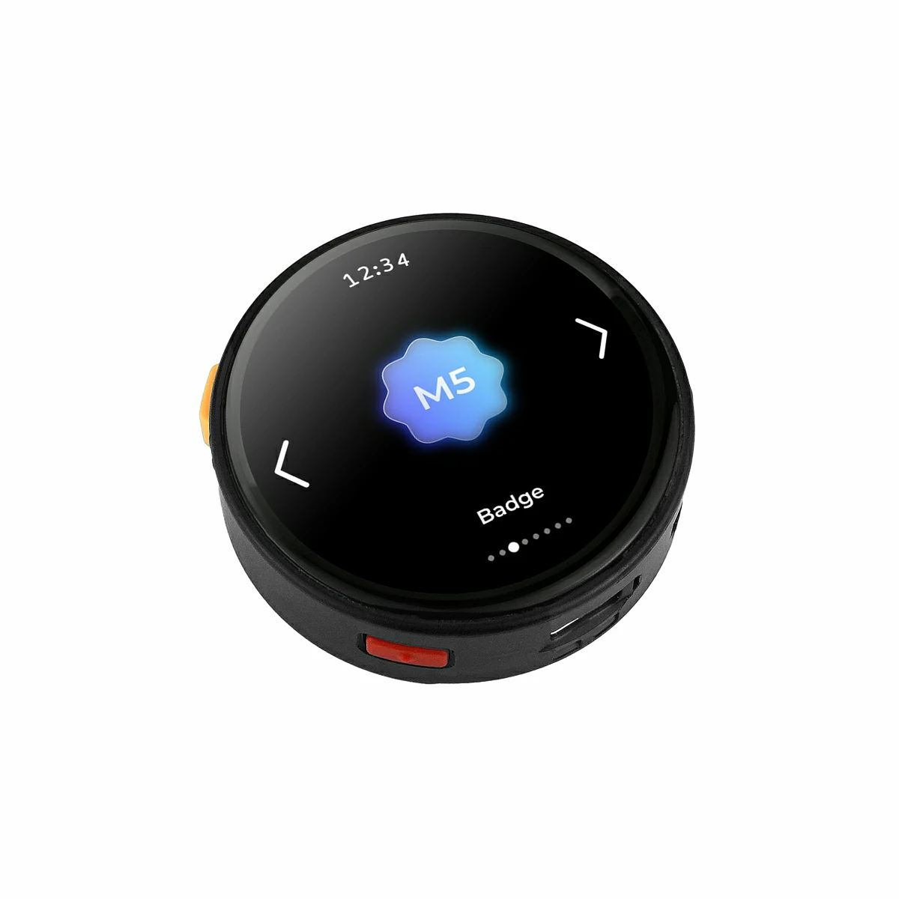

# BSP: M5Stack StopWatch

| [HW Reference](https://docs.m5stack.com/en/core/StopWatch) | [HOW TO USE API](API.md) |
| --- | --- |

> This board support package was **generated with the [ESP-BSP Generator](https://bsp-generator.espressif.tools)**. Keep the saved configuration JSON from your run so you can reload it, adjust pins or features, and regenerate when ESP-IDF or BSP templates change — instead of editing generated files by hand.

## Overview

<table>
<tr><td>

StopWatch is a round AMOLED touch development board designed for portable and interactive scenarios. It features an ESP32-S3R8 main controller with 16MB Flash and 8MB PSRAM, supporting 2.4GHz Wi-Fi wireless communication. The device integrates a 1.75" AMOLED touch round screen, programmable buttons, and vibration feedback for an intuitive human-machine interaction experience. It also features audio input/output, IMU attitude sensing, RTC timekeeping, and multiple expansion interfaces. Combined with the M5PM1 multi-level power management system and a 450mAh battery, it meets diverse development needs including portable smart control, wearable human-machine interaction, and lightweight IoT terminals.

</td><td width="200" valign="top">
  
</td></tr>
</table>

## Capabilities and dependencies

<!-- START_DEPENDENCIES -->

|     Available    |       Capability       |Controller/Codec|                                                   Component                                                  |Version|
|------------------|------------------------|----------------|--------------------------------------------------------------------------------------------------------------|-------|
|:heavy_check_mark:|     :pager: DISPLAY    |     co5300     |                                                      idf                                                     | >=5.4 |
|:heavy_check_mark:|:black_circle: LVGL_PORT|                |        [espressif/esp_lvgl_port](https://components.espressif.com/components/espressif/esp_lvgl_port)        |   ^2  |
|:heavy_check_mark:|    :point_up: TOUCH    |     cst816s    |[espressif/esp_lcd_touch_cst816s](https://components.espressif.com/components/espressif/esp_lcd_touch_cst816s)|   *   |
|:heavy_check_mark:| :radio_button: BUTTONS |                |               [espressif/button](https://components.espressif.com/components/espressif/button)               |   ^4  |
|        :x:       |   :white_circle: KNOB  |                |                                                                                                              |       |
|:heavy_check_mark:|  :musical_note: AUDIO  |                |        [espressif/esp_codec_dev](https://components.espressif.com/components/espressif/esp_codec_dev)        |  ~1.5 |
|:heavy_check_mark:| :speaker: AUDIO_SPEAKER|                |                                                                                                              |       |
|:heavy_check_mark:| :microphone: AUDIO_MIC |                |                                                                                                              |       |
|        :x:       |  :floppy_disk: SDCARD  |                |                                                                                                              |       |
|        :x:       |       :bulb: LED       |                |                                                                                                              |       |
|        :x:       |     :camera: CAMERA    |                |                                                                                                              |       |
|        :x:       |      :battery: BAT     |                |                                                                                                              |       |
|:heavy_check_mark:|    :video_game: IMU    |                |                                                                                                              |       |
|        :x:       | :thermometer: HUMITURE |                |                                                                                                              |       |

<!-- END_DEPENDENCIES -->

## Compatible BSP Examples

<!-- START_EXAMPLES -->

| Example | Description | Try with ESP Launchpad |
| ------- | ----------- | ---------------------- |
| [Display Example](https://github.com/espressif/esp-bsp/tree/master/examples/display) | Show an image on the screen with a simple startup animation (LVGL) | [Flash Example](https://espressif.github.io/esp-launchpad/?flashConfigURL=https://espressif.github.io/esp-bsp/config.toml&app=display-) |
| [LVGL Demos Example](https://github.com/espressif/esp-bsp/tree/master/examples/display_lvgl_demos) | Run the LVGL demo player - all LVGL examples are included (LVGL) | [Flash Example](https://espressif.github.io/esp-launchpad/?flashConfigURL=https://espressif.github.io/esp-bsp/config.toml&app=display_lvgl_demos-) |

<!-- END_EXAMPLES -->

